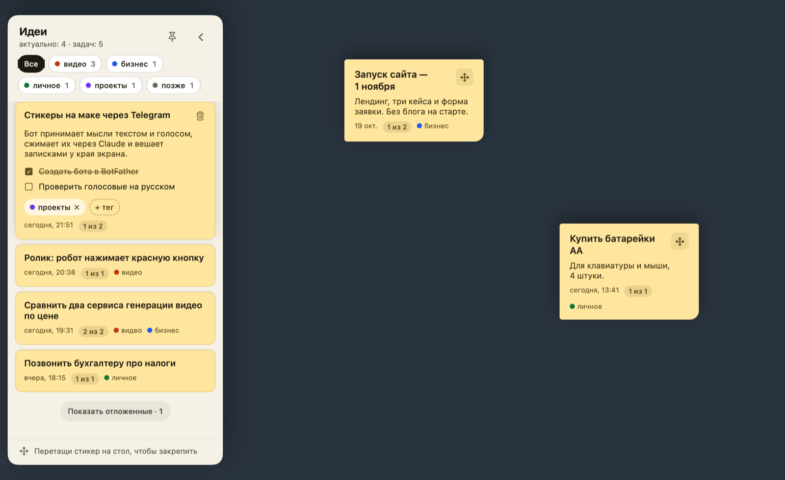

# AI Stickers

**Send a thought to a Telegram bot — it shows up as a sticky note on your Mac.**

[Русская версия](README.ru.md)



Ideas come at random moments, and they get lost across dozens of chats and notes apps.
AI Stickers gives them one inbox: a private Telegram bot. Type or dictate a messy thought,
and a few seconds later it sits on your Mac as a short, tidy sticky note with a summary and
a checklist. It lives at the edge of your screen, where you will actually see it.

## How it works

```
Telegram  ──►  AI Stickers.app on your Mac
(text or voice)   │
                  ├─ voice → text locally: ffmpeg + whisper.cpp
                  ├─ text → sticker via your `claude` CLI (Haiku):
                  │    title · 1–3 sentence summary · todos · up to 2 of your tags
                  └─ sticker → the ideas panel at the left screen edge
```

- **No server.** The app long-polls Telegram itself. Telegram keeps messages for 24 hours,
  so ideas you send while the Mac sleeps arrive when it wakes.
- **No API keys.** Summaries go through the `claude` CLI and your Claude subscription.
- **Nothing gets lost.** If Claude fails, the raw text becomes the sticker.

## Features

- **Edge tab** at the left screen edge shows how many ideas are open. Hover it to slide out the panel.
- **Cards expand on hover**: summary, a checklist (ticks are saved), tags, and delete with a few seconds to undo.
- **Tags.** Filter chips at the top of the panel; pick several at once. On a card, `×` removes a tag and `+ тег` adds an existing or a new one.
- **`#tag` in a message** sets that tag right away. Claude adds up to 2 more, but only from tags you already use.
- **«позже» (later)** is a built-in tag that hides ideas that are not relevant yet; one click shows them again.
- **Pin to the desktop.** Drag a card out of the panel and it becomes a free-floating sticker. Move it by its ✥ handle, hover it to see the checklist, send it back to the panel with one click.
- **Menu bar icon** shows the app is running: show ideas, launch at login, quit.
- **Starts at login**, has no Dock icon, and only one copy runs at a time.

## Requirements

- macOS 14 or later
- Xcode or the Command Line Tools (to build)
- [Homebrew](https://brew.sh): `brew install ffmpeg whisper-cpp`
- A whisper.cpp model, e.g. multilingual [`ggml-small.bin`](https://huggingface.co/ggerganov/whisper.cpp/tree/main)
- [Claude Code](https://claude.com/claude-code) installed and signed in (`claude` on your machine)
- A Telegram account

## Install

1. **Create a bot.** Message [@BotFather](https://t.me/BotFather), send `/newbot`, copy the token.
2. **Write the config** at `~/.config/ai-stickers.env`:

   ```
   TELEGRAM_BOT_TOKEN=123456:ABC...
   ```

3. **Build and install:**

   ```bash
   git clone https://github.com/nitsiyevskii/ai-stickers.git
   cd ai-stickers
   ./scripts/install.sh
   ```

   This builds `AI Stickers.app`, copies it to `/Applications`, starts it and adds it to your
   login items. Run the same command to update after pulling new code.

4. **Claim the bot.** Send it any message. It replies with your Telegram ID; add it to the config:

   ```
   TELEGRAM_USER_ID=123456789
   ```

   Then restart the app (menu bar icon → «Выйти», then open AI Stickers from Applications).
   From now on the bot accepts messages only from you and ignores everyone else.

## Configuration

`~/.config/ai-stickers.env`, one `KEY=value` per line, `#` starts a comment.

| Key | Required | Default |
|---|---|---|
| `TELEGRAM_BOT_TOKEN` | yes | — |
| `TELEGRAM_USER_ID` | yes, after step 4 | — |
| `WHISPER_MODEL` | no | `~/.cache/hyperframes/whisper/models/ggml-small.bin` |
| `FFMPEG` | no | `/opt/homebrew/bin/ffmpeg` |
| `WHISPER_CLI` | no | `/opt/homebrew/bin/whisper-cli` |
| `CLAUDE_BIN` | no | `~/.local/bin/claude` |

Paths must be absolute: an app started at login gets no shell `PATH`.
Point `WHISPER_MODEL` at wherever you saved the model.

Stickers are stored in `~/Library/Application Support/AiStickers/stickers.json`.

## Privacy

- **Voice** is transcribed on your Mac; the audio goes nowhere else.
- **Text** of each idea is sent to Claude through your own `claude` CLI to make the summary.
- **Telegram** carries your messages, as with any bot. The token stays in your local config and is never logged.
- **Stickers** are a local JSON file. No server, account or analytics.

## Development

```bash
swift build && swift test   # the definition of "correct" for every change
swift run                   # dev run: no launch at login, no single-instance check
```

| File | Role |
|---|---|
| `Sources/AiStickers/main.swift` | config, menu bar menu, launch at login, startup |
| `Sources/AiStickers/Bot.swift` | Telegram polling, voice → text, idea → sticker via `claude -p` |
| `Sources/AiStickers/Store.swift` | sticker model, JSON storage, filters and tags (pure, tested) |
| `Sources/AiStickers/Board.swift` | windows: edge tab, panel, pinned stickers, dragging |
| `Sources/AiStickers/Views.swift` | SwiftUI views |
| `scripts/install.sh` | builds and installs `AI Stickers.app` |

Plain SwiftPM, no dependencies. Every change goes through its own branch and a pull request
that explains what changed and how it works. Rules for contributors and coding agents are in
[CLAUDE.md](CLAUDE.md) and [AGENTS.md](AGENTS.md).

## Limitations

- The interface is in Russian.
- Telegram is the only input for now.
- The app is built and ad-hoc signed on your own Mac; there is no notarized download.
- Tag colors follow alphabetical order, so adding a tag can shift the colors of others.
